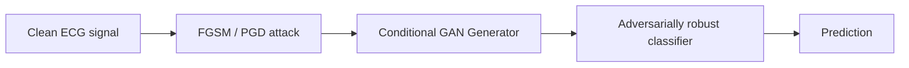

## Overview

ECG classifiers deployed in clinical decision-support systems are increasingly built on deep
neural networks — and like any deep network, they're vulnerable to small, carefully chosen
perturbations that flip a prediction without any visible change to the signal. In a clinical
setting, that's not a theoretical concern: a misclassified arrhythmia is a patient-safety issue,
not just a benchmark number.

This was the thesis work behind my M.Sc. at IASBS, supervised by Prof. Dr.-Ing. Mahdi Bohlouli:
**TL-CGAN**, a transfer-learning framework built on conditional GANs that hardens a pretrained
ECG classifier against adversarial attacks without requiring a full retrain from scratch.

## Motivation

A standard single-step attack like FGSM perturbs an input $x$ in the direction that most
increases the model's loss:

$$
x' = x + \epsilon \cdot \text{sign}(\nabla_x J(\theta, x, y))
$$

Stronger, iterative attacks like PGD repeat this step under a bounded perturbation budget:

$$
\delta^* = \arg\max_{\|\delta\|_\infty \le \epsilon} J(\theta, x + \delta, y)
$$

Standard adversarial training — augmenting the training set with examples like these — works,
but it's expensive and doesn't always transfer well to a model that's already been trained and
deployed. TL-CGAN was motivated by a more practical question: **can we harden a pretrained
classifier against these attacks efficiently, using transfer learning instead of training a
robust model from the ground up?**

## Method

The core idea is to replace a fixed attack generator with a *conditional* one, trained jointly
with a discriminator, so the perturbations it produces stay realistic and class-consistent
rather than purely adversarial noise:

$$
\mathcal{L}_{TL\text{-}CGAN} = \mathbb{E}_{x,y}\left[\log D(x, y)\right] + \mathbb{E}_{z,y}\left[\log(1 - D(G(z, y), y))\right]
$$

The pretrained classifier is then fine-tuned against this generator's output rather than
against a fixed, precomputed set of adversarial examples — closer in spirit to the way transfer
learning reuses existing weights than to training a robust model end-to-end.

## Status

The manuscript is currently under revision. Across FGSM and PGD attack budgets, the fine-tuned
classifier keeps clean-signal accuracy close to the unmodified baseline while substantially
closing the accuracy gap under attack — full results and the abstract are on the
[Publications page](/publications/#pub-tlcgan).
