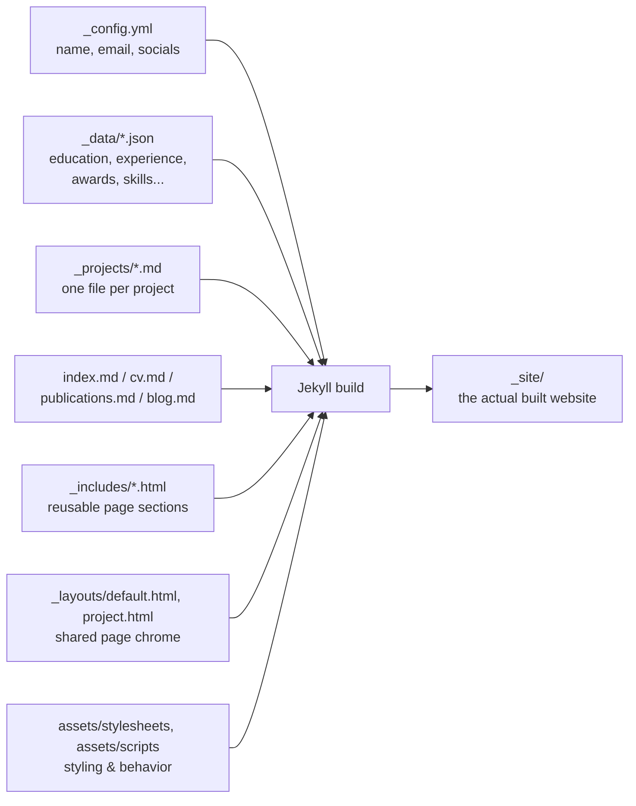

<div class="hero">
  <div class="hero-inner">
    <div class="hero-text hero-text--full">
      <div class="eyebrow">Reference</div>
      <h1>Site Architecture Guide</h1>
      <p class="role">How this site is put together, what's editable and where, with real examples.</p>
    </div>
  </div>
</div>
<main>
<div class="content-body" markdown="1">

This page isn't linked anywhere in the nav either — it's a private reference, same idea as
`/style-guide/`, just for the site as a whole instead of one page's Markdown features. Bookmark
it; you'll want to come back to it.

## The big picture

This is a Jekyll site. Jekyll takes plain text files (Markdown, YAML, JSON) and a set of
reusable HTML templates, and combines them at build time into the static HTML/CSS/JS that
actually gets served to visitors. Nothing runs on a server per-visit — the whole site is
pre-built once, then served as flat files. That's why editing content always means editing a
source file and rebuilding, never clicking a "save" button on a live page.



## Where everything lives — file tree

```
site/
├── _config.yml              site identity: name, email, phone, location, socials
├── index.md                  homepage (profile card, interests, research focus)
├── cv.md                      /cv/ page (background, education, experience, publications, skills, PDF download)
├── projects.md                 /projects/ page (project grid + publications teaser)
├── publications.md              /publications/ page (full list, search, abstracts, BibTeX)
├── news.md                       /news/ page (reverse-chronological updates timeline)
├── teaching.md                    /teaching/ page (teaching & mentoring grid)
├── cv.md                            /cv/ page (downloadable CV PDF)
├── blog.md                           /blog/ page
├── style-guide.md                  live demo of every content feature (this file's sibling)
├── guide.md                         this page
├── 404.html                          custom 404 page
├── robots.txt                         crawler rules + sitemap pointer
│
├── _data/                    JSON content — edit these for text changes, no HTML touched
│   ├── home.json               home page intro paragraphs, interests, compact education list
│   ├── research_focus.json      home page "Research Focus" bullets
│   ├── background.json           About page "Background" paragraph
│   ├── education.json             About page "Education" section
│   ├── experience.json             About page "Experience" accordion (id, open, tags, bullets)
│   ├── awards.json                  About page "Awards, Honors & Scholarships"
│   ├── skills.json                   About page "Skills" grid
│   ├── publications.json              Publications page + Projects page publications teaser +
│   │                                    home page "Latest Publications" card (via `featured`)
│   ├── news.json                       News page timeline (date, type, icon, html)
│   └── teaching.json                    Teaching page grid (role, title, description, date)
│
├── _projects/                 one Markdown file per project — each becomes its own page at
│   ├── tlcgan.md                 /projects/:slug/ (set by the `projects` collection in
│   ├── skin-cancer-segmentation.md _config.yml). Front matter drives the card on /projects/
│   ├── handwritten-digit-emotion.md AND the hero/tags/links on the individual page; the
│   └── iot-consortium.md             Markdown body below it is the full write-up — supports
│                                      headings, math, tables, code, Mermaid diagrams, and
│                                      everything else documented on /style-guide/.
│
├── _posts/                    one Markdown file per blog post, named YYYY-MM-DD-slug.md
│   └── (empty until the first real post is added — /blog/ shows a "coming soon" card
│         until then; same Markdown feature set as _projects/)
│
├── _includes/                 reusable HTML fragments, stitched together by each page
│   ├── head-meta.html            <head>: title, description, fonts, OG/Twitter meta,
│   │                                Person JSON-LD, KaTeX (conditional)
│   ├── og-meta.html                Open Graph + Twitter Card tags (social share previews)
│   ├── person-jsonld.html           schema.org Person structured data
│   ├── header-nav.html               top nav bar + mobile hamburger menu
│   ├── footer.html                    shared footer
│   ├── home-content.html                 home page body
│   ├── cv-content.html                    CV page body (background, education, experience, skills, PDF download)
│   ├── projects-content.html               projects page body (reads the projects collection)
│   ├── publications-content.html            publications page body (search, abstract/BibTeX)
│   ├── news-content.html                     news page body (reads news.json)
│   ├── teaching-content.html                  teaching page body (reads teaching.json)
│   ├── blog-content.html                       blog page body (reads site.posts, full-bleed band)
│   └── cv-content.html                          cv page body (download card)
│
├── _layouts/
│   ├── default.html            shared chrome every page wraps in: head, nav, {{ content }}, footer
│   ├── project.html             individual project page chrome — chains into default.html,
│   │                              adds the hero/tags/cover/content-body/links-row wrapper
│   └── post.html                  individual blog post chrome — chains into default.html,
│                                    adds the hero (title/date/read-time/tags) + content-body
│
├── assets/
│   ├── stylesheets/main.css      all visual styling — unchanged from the original clarity-template
│   ├── img/covers, img/og-cover.png    publication thumbnails + social-share preview image
│   ├── cv/morteza-abedi-cv.pdf           the downloadable CV file linked from /cv/
│   └── scripts/
│       ├── navbar.js               active-link highlighting, mobile menu, back-to-top button
│       └── content-features.js      heading anchors, code tabs, code-copy, mermaid, pseudocode,
│                                       experience accordion, abstract/BibTeX toggles
│
├── Dockerfile, docker-compose.yml, .dockerignore    local preview, no Ruby install needed
├── Gemfile, Gemfile.lock                             pinned Jekyll version + plugins
└── SETUP.md                                           step-by-step run/deploy instructions
```

## Editing content

- **Education, awards, skills, home-page intro/research focus, publications** → edit the
  matching file in `_data/*.json`. Save, and the running server (Docker or local) rebuilds
  automatically. See `SETUP.md` for exactly which file maps to which section.
- **The homepage Contact section** (headline, buttons, copyable email/phone) → lives directly in
  `_includes/home-content.html` since it's a one-off, not repeating list data. Email and phone
  pull from `_config.yml`; edit the headline/subtext text right in the include.
- **Home page "Latest Publications" / "Selected Projects"** → controlled by a `featured` flag,
  not recency, so you choose exactly what shows up.
  - In `_data/publications.json`, add `"featured": true` to any entry you want on the homepage
    (up to 3 shown). Add a `"type"` field too if you want the small badge next to it — any label
    works ("Journal", "Preprint", "Review", ...).
  - In the front matter of any file in `_projects/`, add `featured: true` (up to 2 shown). See
    the project front-matter example below for where it goes.
  - Leave the flag off, or set it `false`, to keep something off the homepage while it stays
    fully visible on its own full listing page (`/publications/` or `/projects/`).
- **Experience** → also `_data/experience.json`, but each entry renders as an accordion on the
  About page. Fields: `id` (unique string), `title`, `org`, `dates`, `open` (`true` for the one
  entry that should start expanded, `false` for the rest), `tags` (array of chip labels, can be
  empty `[]`), `bullets` (array of detail lines shown when expanded).
- **A new project** → add a Markdown file to `_projects/`. The front matter drives both the card
  on `/projects/` and the hero/tags/links on the project's own page:
  ```yaml
  ---
  layout: project
  title: "Project Title"
  subtitle: "One sentence used in the page hero."
  description: "Used for the summary text on the listing card."
  tag: "M.Sc. Thesis · 2024"        # short label shown above the title
  status: "completed"                # or "in progress", "under revision", etc.
  order: 5                            # controls sort position on /projects/
  tags: ["Tag One", "Tag Two"]         # chip row on both the card and the page
  thumbnail: /assets/img/covers/your-cover.png   # optional cover image
  featured: true                                  # optional — show this project in the
                                                     # "Selected Projects" card on the
                                                     # homepage (max 2 shown, see below)
  math: true                                      # set true only if the body uses $...$ math
  links:
    code: "https://github.com/you/repo"            # optional
    demo: "https://..."                             # optional
    paper: "/publications/#pub-anchor"               # optional, can be internal or external
  ---

  The Markdown body below the front matter is the full write-up — everything documented on
  `/style-guide/` (headings, math, tables, code blocks, Mermaid diagrams, footnotes, figures)
  is available here too. Add `hidden: true` to keep a project off the `/projects/` grid while
  its page stays live, for drafts or reference pages.
  ```
- **A new blog post** → add a Markdown file to `_posts/`, named `YYYY-MM-DD-slug.md` (the date
  prefix is required by Jekyll's post collection and sets the post's publish date and sort
  order; the slug becomes the URL, e.g. `/blog/your-slug/`):
  ```yaml
  ---
  layout: post
  title: "Post Title"
  tags: ["Tag One", "Tag Two"]    # optional, shown as chips on the card and the post
  excerpt: "One or two sentences — used as the card preview text and the page's meta description."
  math: true                       # set true only if the body uses $...$ math
  ---

  The Markdown body is the full post — same feature set as projects (headings, math, tables,
  code blocks with copy buttons, Mermaid diagrams, code tabs, pseudocode, footnotes, figures,
  video). Read time is calculated automatically from word count, no field needed. Until there's
  at least one real post, `/blog/` shows a "coming soon" card instead of an empty grid.
  ```
- **Your name, email, phone, location, socials** → edit `_config.yml` (restart `jekyll serve`
  after changing this file — Jekyll doesn't watch its own config for live changes).
- **Page structure / markup** → the shared chrome lives in `_includes/header-nav.html`,
  `_includes/footer.html`, `_includes/head-meta.html`. Each page's body markup lives in
  `_includes/home-content.html`, `cv-content.html`, `projects-content.html`,
  `publications-content.html` — these loop over the JSON/collection data above using Liquid
  (Jekyll's templating language), so routine content edits shouldn't need to touch them at all.
- **Styling** → `assets/stylesheets/main.css` is unchanged from the original clarity-template
  design; the added responsive rules, content-feature styles, accordion, and project-detail
  styles live at the bottom of the same file, clearly marked off in their own sections.
- **Dark/light theme** → toggled via the switch in the nav, persisted to `localStorage`, applied
  as `data-theme="dark"`/`"light"` on `<html>`. Both palettes are defined once, in the `:root`
  and `html[data-theme="dark"]` blocks at the very top of `main.css` — change a color there and
  it updates everywhere that token is used. See "Color palette & theming" below for the full
  breakdown of what every token means and where dark-theme-specific overrides live.
  Mermaid diagrams re-render automatically in the matching theme when the toggle is clicked.
- **A future blog post or long write-up** → give the page's front matter `layout: default` and
  `math: true` (if it uses any math), then wrap the Markdown body in
  `<div class="content-body" markdown="1">...</div>` exactly like `style-guide.md` does. Every
  feature demonstrated on `/style-guide/` — math, tables, code blocks with copy buttons, code
  tabs, Mermaid diagrams, pseudocode, footnotes, figures, embedded video — becomes available
  the moment that wrapper is in place. (Project pages get this automatically via `layout: project`
  — no wrapper needed there.)

## Color palette & theming

Every color on the site traces back to a small set of CSS custom properties defined once, at
the top of `assets/stylesheets/main.css` — a `:root` block for light theme, and an
`html[data-theme="dark"]` block for dark. Nothing else in the stylesheet should contain a raw
hex color for anything that's supposed to follow the theme; if you ever spot one, it's a bug
(see "Known fixed-color exceptions" below for the handful that are deliberate).

### The five core tokens

| Token | Role | Light value | Dark value |
|---|---|---|---|
| `--ink` | Primary text, headings, main readable content | `#151715` | `#E0E1DD` |
| `--ink-soft` | Icons, links, short meta labels (dates, venues, captions) | `#5A7684` | `#5A7684` |
| `--paper` | Page background | `#E0E1DD` | `#151715` |
| `--accent` | Primary accent — buttons, active states, highlighted words | `#B58A3A` | `#B58A3A` |
| `--accent-2` | Secondary accent — a second badge/tag color, bold emphasis within muted text | `#A98743` | `#A98743` |

To swap the whole site to a new palette, these ten values (five tokens × two themes) are the
first and most important place to change. Everything below this table exists because the dark
theme in particular needed values these five tokens alone don't cover.

### Derived surface tokens (dark theme only)

Light theme's `--paper-raised` and `--paper-strong` still track `--paper` directly (no visual
distinction between page background and card background in light mode). Dark theme needed a
genuinely different surface color for cards, the search bar, buttons, and badges — this was the
single biggest source of "why doesn't this match" bugs during this build, because it isn't one
of the five core tokens and has to be set explicitly:

| Token | Dark value | Used for |
|---|---|---|
| `--paper-raised` | `#1E2120` | Cards (Research Areas, Latest Publications, project cards, CV closing card) |
| `--paper-strong` | `#1E2120` | Search bar, input fields, chips, badges, thumbnails |
| `--line` | `#2A2D2A` (solid, not the light theme's semi-transparent version) | All borders and dividers |

The sidebar (`.site-rail`) and each page's title banner (`.hero`) deliberately use `--paper`
directly, not `--paper-raised` — they're meant to sit flush with the page background, not read
as a card. Icon circles (Research Areas, CV skill categories, project detail-section headers)
use two more dark-theme-specific values not tied to a token: background `#24343B`, icon color
`#5A7684`.

### The text-brightness rule (the actual lesson from this build)

The recurring bug across this whole palette pass was assuming secondary-looking text should use
`--ink-soft`. In practice the rule that actually matches the intended design is:

- **Bright (`--ink` / `#E0E1DD`)** — anything a visitor is meant to *read*: descriptions,
  summaries, bullet lists (Key Results, Impact, Experience bullets), author names, chip/tag
  text, awards text, abstracts, blog body copy.
- **Muted (`--ink-soft` / `#5A7684`)** — anything that's a *label*, not content: icons, dates,
  venues, placeholder text, search-preview snippets, small caption lines under images.
- **Secondary accent (`--accent-2` / `#A98743`)** — bold/emphasized spans *within* otherwise
  muted or bright text (journal names inside an award line, "robustness"/"trustworthy" inside
  the hero paragraph).

When adding a new text element, ask "is this the actual content, or a label about the
content?" — that answer picks the color, almost always correctly.

### Known fixed-color exceptions

A few colors are intentionally independent of the theme and won't change with a palette swap —
don't "fix" these by mistake:

- `#12181f` — the dark badge background behind the ECG avatar icon (home hero, sidebar logo,
  "Selected Projects" thumbnails with no cover image). Meant to read as a device screen, same
  in both themes.
- `#9C6B2E` — one Rouge syntax-highlighting color (string literals in code blocks). Unrelated
  to the site's own palette.
- Publication/project type badges (Journal, Preprint, etc.) use `--accent` and `--accent-2`
  directly as an outlined border+text style in dark theme, not a token of their own — see
  `.pub-type-badge--*` and `.timeline-status` in main.css if you add a new type value.

## Deploying

The included GitHub Actions workflow (`.github/workflows/pages.yml`) builds and deploys this
site to GitHub Pages automatically on every push to `main` — no manual build step. Full
step-by-step instructions, including the Docker-based local preview, are in `SETUP.md`.

</div>
</main>
