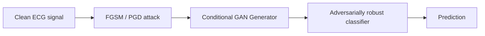

<div class="hero">
  <div class="hero-inner">
    <div class="hero-text hero-text--full">
      <div class="eyebrow">Reference</div>
      <h1>Style Guide</h1>
      <p class="role">Not a real page — a living reference for every Markdown feature available for long-form content on this site, demonstrated with examples from my own research.</p>
    </div>
  </div>
</div>
<main>
<div class="content-body" markdown="1">

This page isn't linked anywhere in the nav — it's `style-guide.md`, kept here purely as a
reference for adding rich content (like a blog post) later. Every section follows the same
pattern: **the exact Markdown you'd type**, then **what it actually looks like rendered**,
right underneath it.

To use any of this on a page, wrap the Markdown body in `<div class="content-body" markdown="1">`
(exactly as this page does), and set `math: true` in the front matter if the page uses any
`$...$` or `$$...$$` math — that flag is what loads KaTeX only on pages that actually need it.

## Headings

**Code:**

```markdown
## A main section
### A subsection
```

**Output:** hover over any heading on this page and a small `#` appears on the right — a
permalink to that exact section, added automatically to every `##`/`###` inside `.content-body`.

### This heading is the subsection example

Subsections are for breaking a section like Method or Results into smaller pieces.

## Text formatting

**Code:**

```markdown
Standard Markdown: **bold text**, *italic text*, `inline code`, and [links](https://example.com).
```

**Output:** Standard Markdown: **bold text**, *italic text*, `inline code`, and
[links](https://example.com).

## Math

**Code:**

```markdown
Inline math sits in a sentence, like $x' = x + \epsilon \cdot \text{sign}(\nabla_x J(\theta, x, y))$.

Display math goes on its own line:

$$
\mathcal{L}_{TL\text{-}CGAN} = \mathbb{E}_{x,y}\left[\log D(x, y)\right] + \mathbb{E}_{z,y}\left[\log(1 - D(G(z, y), y))\right]
$$
```

**Output:** Inline math sits in a sentence, like the FGSM perturbation used to attack an ECG
classifier: $x' = x + \epsilon \cdot \text{sign}(\nabla_x J(\theta, x, y))$. Display math goes
on its own line — the conditional-GAN objective from the TL-CGAN work:

$$
\mathcal{L}_{TL\text{-}CGAN} = \mathbb{E}_{x,y}\left[\log D(x, y)\right] + \mathbb{E}_{z,y}\left[\log(1 - D(G(z, y), y))\right]
$$

**One exception:** if your display math has a subscript immediately followed by `{`, like
`\max_{1 \le i \le n}`, wrap it in a plain `<div class="math-block">` — this stops the
Markdown parser from misreading the underscore as emphasis.

**Code:**

```markdown
<div class="math-block">
$$
\delta^* = \arg\max_{\|\delta\|_\infty \le \epsilon} J(\theta, x + \delta, y)
$$
</div>
```

**Output:**

<div class="math-block">
$$
\delta^* = \arg\max_{\|\delta\|_\infty \le \epsilon} J(\theta, x + \delta, y)
$$
</div>

## Images

A plain image, centered and rounded automatically:

**Code:**

```markdown

```

For a captioned figure, use raw HTML directly in the Markdown:

**Code:**

```markdown
<div class="content-figure">
  
  <figcaption>Caption text goes here.</figcaption>
</div>
```

**Output:**

<div class="content-figure">
  
  <figcaption>Example: predicted segmentation mask overlaid on a histopathological skin cancer slide.</figcaption>
</div>

## Tables

**Code:**

```markdown
| Model | Clean Accuracy | Accuracy under FGSM |
|---|---|---|
| Baseline CNN | 0.94 | 0.31 |
| TL-CGAN (ours) | 0.93 | 0.87 |
```

**Output:**

| Model | Clean Accuracy | Accuracy under FGSM |
|---|---|---|
| Baseline CNN | 0.94 | 0.31 |
| TL-CGAN (ours) | 0.93 | 0.87 |

## Code blocks

Triple backticks with a language tag get automatic syntax highlighting and a copy button.

**Code:**

````markdown
```python
def fgsm_attack(x, epsilon, grad):
    """Single-step adversarial perturbation."""
    return x + epsilon * grad.sign()
```
````

**Output:**

```python
def fgsm_attack(x, epsilon, grad):
    """Single-step adversarial perturbation used to stress-test
    the ECG classifier before conditional-GAN fine-tuning."""
    perturbation = epsilon * grad.sign()
    x_adv = x + perturbation
    return x_adv.clamp(min=-1.0, max=1.0)
```

## Footnotes

**Code:**

```markdown
A claim that needs a source[^1].

[^1]: Author, A. (2024). *Paper Title*. Venue.
```

**Output:** the TL-CGAN approach improves robustness without materially hurting clean
accuracy[^1] — scroll to the bottom of this page to see the numbered reference list kramdown
generates automatically, with a back-link (↩) to jump back up to exactly where you were reading.

## Diagrams

Write a diagram as plain text — flowcharts, sequence diagrams, and more — using
[Mermaid](https://mermaid.js.org/) syntax in a fenced code block, and it renders as an SVG in
the browser.

**Code:**

````markdown

````

**Output:**


mermaid.js is only loaded from CDN on pages that actually contain a diagram, so it doesn't add
weight to every page on the site.

## Video and audio

Self-hosted files use plain HTML5 tags directly in the Markdown — no plugin needed. (The
player below shows real browser-native controls but has no file attached, so it won't play —
swap in a real path from `/assets/video/` and it will.)

**Code:**

```markdown
<video controls>
  <source src="/assets/video/iotrain-summer-school-talk.mp4" type="video/mp4">
</video>
```

**Output:**

<video controls></video>

For an embedded YouTube/Vimeo video, wrap the `<iframe>` in `content-video` for a responsive
16:9 box that scales with the column width instead of overflowing on mobile:

**Code:**

```markdown
<div class="content-video">
  <iframe src="https://www.youtube.com/embed/VIDEO_ID" title="Video title" allowfullscreen></iframe>
</div>
```

**Output:** a 16:9 box the same width as this text column — actual video omitted here since it
needs a real `VIDEO_ID`, but the responsive box itself looks like this:

<div class="content-video" style="background:rgba(119,141,169,0.16); display:flex; align-items:center; justify-content:center; color:var(--ink-soft); font-family:'IBM Plex Mono', monospace; font-size:13px;">16:9 responsive box — your embedded video goes here</div>

## Code tabs

For showing the same snippet in multiple languages, use a `code-tabs` block — click a tab to
switch which code panel shows. Each panel needs its own fenced code block, and `markdown="1"`
on every nested `<div>` so kramdown parses the Markdown inside instead of treating it as raw
HTML — copy this structure exactly rather than freehanding it:

**Code:**

````markdown
<div class="code-tabs" markdown="1">
<div class="code-tabs-nav">
  <button class="code-tab-btn active" data-tab="python">Python</button>
  <button class="code-tab-btn" data-tab="matlab">MATLAB</button>
</div>

<div class="code-tabs-panel active" data-tab="python" markdown="1">
```python
def normalize_ecg(signal):
    return (signal - signal.mean()) / signal.std()
```
</div>

<div class="code-tabs-panel" data-tab="matlab" markdown="1">
```matlab
function n = normalize_ecg(signal)
    n = (signal - mean(signal)) / std(signal);
end
```
</div>

</div>
````

**Output** — try clicking the tabs, or press Tab to focus one and use the arrow keys:

<div class="code-tabs" markdown="1">
<div class="code-tabs-nav">
  <button class="code-tab-btn active" data-tab="python-demo">Python</button>
  <button class="code-tab-btn" data-tab="matlab-demo">MATLAB</button>
</div>

<div class="code-tabs-panel active" data-tab="python-demo" markdown="1">
```python
def normalize_ecg(signal):
    return (signal - signal.mean()) / signal.std()
```
</div>

<div class="code-tabs-panel" data-tab="matlab-demo" markdown="1">
```matlab
function n = normalize_ecg(signal)
    n = (signal - mean(signal)) / std(signal);
end
```
</div>

</div>

`active` on the first tab button and its matching panel controls which one shows by default.
Keyboard accessibility (arrow-key navigation, `role`/`aria-selected` for screen readers) is
applied automatically at runtime.

## Pseudocode

For an algorithm's pseudocode specifically, use a ` ```pseudocode ` fenced block with LaTeX
`algorithmic`-style syntax — it renders as a properly typeset algorithm box with line numbers.
**Use `$$...$$` for any math inside it, never single `$`** — single `$` gets caught by the
page's general math rendering first and corrupts the raw syntax before the pseudocode renderer
gets to parse it.

**Code:**

````markdown
```pseudocode
\begin{algorithm}
\caption{TL-CGAN Adversarial Fine-Tuning}
\begin{algorithmic}
\PROCEDURE{TrainRobustClassifier}{$$x, y, \epsilon, T$$}
    \FOR{$$t = 1$$ \TO $$T$$}
        \STATE $$x_{adv} \gets$$ \CALL{FGSM}{$$x, y, \epsilon$$}
        \STATE $$x_{gen} \gets$$ \CALL{Generator}{$$x_{adv}, y$$}
        \STATE Update classifier on $$x_{gen}$$
    \ENDFOR
\ENDPROCEDURE
\end{algorithmic}
\end{algorithm}
```
````

**Output:**

```pseudocode
\begin{algorithm}
\caption{TL-CGAN Adversarial Fine-Tuning}
\begin{algorithmic}
\PROCEDURE{TrainRobustClassifier}{$$x, y, \epsilon, T$$}
    \FOR{$$t = 1$$ \TO $$T$$}
        \STATE $$x_{adv} \gets$$ \CALL{FGSM}{$$x, y, \epsilon$$}
        \STATE $$x_{gen} \gets$$ \CALL{Generator}{$$x_{adv}, y$$}
        \STATE Update classifier on $$x_{gen}$$
    \ENDFOR
\ENDPROCEDURE
\end{algorithmic}
\end{algorithm}
```

## Links block

This site's existing `.project-link-btn` style (already used on the Projects page) doubles as
a simple "paper / code / demo" link row for a write-up:

**Code:**

```markdown
<div class="chip-row">
  <a class="project-link-btn" href="#">Paper</a>
  <a class="project-link-btn" href="#">Code</a>
  <a class="project-link-btn" href="#">Demo</a>
</div>
```

**Output:**

<div class="chip-row">
  <a class="project-link-btn" href="#" onclick="return false;">Paper</a>
  <a class="project-link-btn" href="#" onclick="return false;">Code</a>
  <a class="project-link-btn" href="#" onclick="return false;">Demo</a>
</div>

[^1]: Abedi, M., & Bohlouli, M. (2025). *TL-CGAN: How Transfer Learning Conditional GAN Makes Robustness of Electrocardiogram (ECG) Signals Against Adversarial Attacks*. PLOS ONE (under revision).

</div>
</main>
